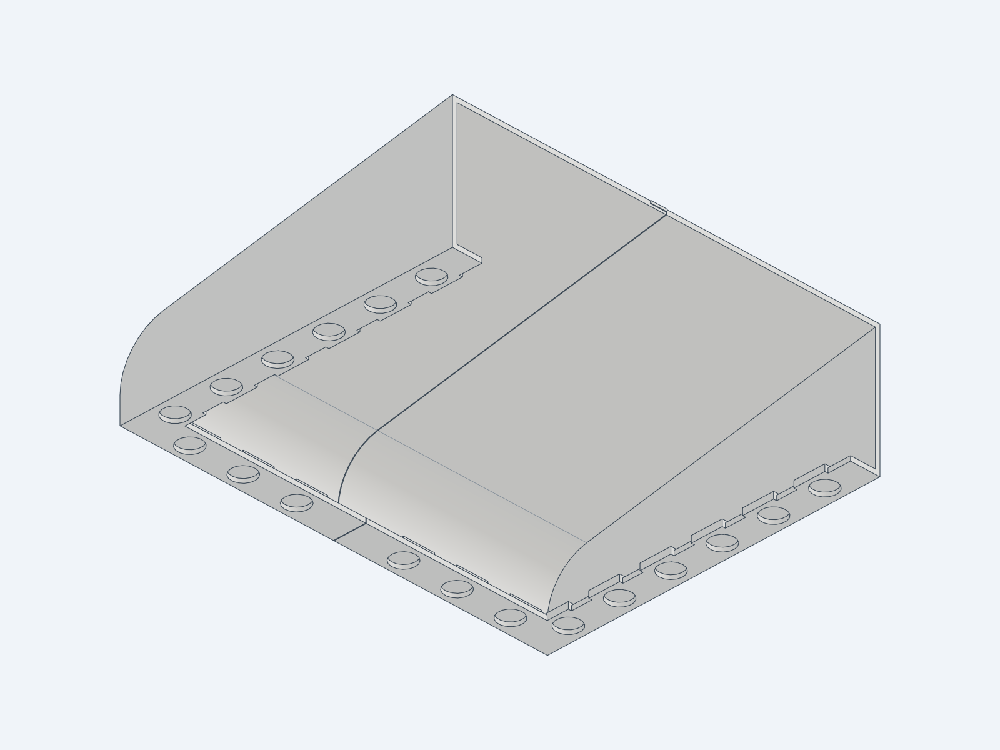

# Magnetic two-piece deflector for a 225 × 175 mm vent

This version removes the vent-holder slots completely. The deflector approaches the vent straight along the mounting-face normal; the vent does not need to flex or slide through anything. The two halves retain their centre open overlap joint, flat outer end faces and curved airflow scoop.

The rear scoop wall now meets the outside mounting edge, enclosing the horizontal rim inside the deflector just like the side rims. The curved transition starts 10 mm farther back; the front edge and overall footprint stay fixed. Side magnet centers move 1 mm inward to clear the larger reinforcing pads.

The side mounting rims remain **15.5 mm wide**. The horizontal rim is **17.0 mm wide**, enlarged inward to fit its larger magnet pads. The 225 × 175 mm outside footprint is preserved.

The centre joint uses a 1.2 mm thick overlap over an open 1.2 mm recessed edge, with 0.3 mm clearance. A shallow 26.6° ramp builds the overlap root when printed on the flat outer end. The captured socket and its returned lip have been removed. The joint aligns the halves but does not lock them together; each half is retained by its magnets. Slicer and physical print verification remain necessary.



[Dimensions](DIMENSIONS.md) · [Exploded render](previews/two_pieces.png) · [Underside render](previews/underside.png)

## Magnets and mounting

The user confirmed round **Ø12 × 2 mm magnets** and a magnet-attracting vent border.

- Eighteen blind pockets: nine per half (six along the side and three along the horizontal rim), **Ø12.3 × 2.1 mm deep**.
- Each pocket has **1.3 mm solid material underneath**, with a 2 mm radial wall on its local reinforcing pad.
- Pockets open toward the vent, at mounting plane Z=0. Bond magnets into the pockets; the 0.1 mm extra depth permits a thin adhesive layer with the magnet face approximately flush. These are clearance pockets, not a press fit.
- Pocket centres are X=±103.5 mm and Y=7.6, 34.6, 61.6, 88.6, 115.6, 142.6 mm. The vent rectangle and mounting footprint are both X=±112.5 mm, Y=−12.4…162.6 mm. Thus the centres are 9 mm inward from the side edges and 20, 47, 74, 101, 128, 155 mm from the rear edge.
- Added horizontal pocket centres are X=±28.125, ±56.25 and ±84.375 mm, Y=−3.75 mm, placing them 8.65 mm inward from the rear edge.
- Each side magnet needs approximately **15 mm of solid border width inward from the outside edge**; each horizontal magnet needs about **14.7 mm inward from the rear edge** for its whole face to overlap metal. Use the thin test frame to confirm all eighteen locations land on metal rather than grille openings, screw heads or embossing.
- Magnetic holding force depends on magnet grade, paint, gaps and the actual border. It has not been load-tested; the eighteen-pocket layout is not a verified ceiling-retention rating. Check attachment on the actual vent before leaving the full part installed.

The vent and finished magnetic mounting footprint are both **225 × 175 mm**. Overall deflector: **225 × 175 × 67.742 mm**. The former surround allowance has been removed following the physical fit-test photo: the previous 231.8 × 189.4 mm model was 6.8 mm wider and 14.4 mm longer than the vent. This is a face-mounted magnetic design, not a frame sized to surround the vent. Ledges and magnet pads remain inside the vent outline. The grille thickness is not constrained by a slot.

The photo establishes the overhang but is not used as a calibrated ruler. This correction uses the user-provided 225 × 175 mm measurement; physical flush fit should be checked with the revised thin frame.

## Files

All STL files below are updated to this magnetic version. Matching exact solids are in `STEP/`.

| Version | STL files | Purpose |
| --- | --- | --- |
| Full deflector | `deflector_left.stl`, `deflector_right.stl` | Final magnetic two-piece scoop |
| Thin fit frame | `fit_frame_left.stl`, `fit_frame_right.stl` | Complete mounting footprint and all eighteen pockets, only 5.6 mm tall |
| First-layer samples | `first_layers_left.stl`, `first_layers_right.stl` | Exact first 18 mm from each flat outer end, including the six side magnet pads |

`vent_assembly.step` is the full assembly; `vent_exploded.step` separates the halves; `fit_frame_assembly.step` shows the assembled test frame. Reviewed images and geometric results are in `previews/`.

### Fit test and print orientation

Start with the **thin fit frame**. Assemble the two halves, hold against the vent and verify the footprint, magnet contact locations and pocket fit. As exported, the mounting face lies on the bed and the pocket floors bridge over the bores. Inspect those bridges in the slicer, or select a supported orientation. This is a geometry sample, not the full part's strength or final print-orientation test. The current CAD volume fraction is recorded in `previews/validation.json`.

The first-layer samples are pre-oriented with the broad flat end on the bed. They are now **18 mm / 90 uniform 0.20 mm layers**, because the inward reinforcing pads need more depth than the old holder slots. They are literal cuts of the final part and include six complete side pockets each; the three horizontal pockets are outside these end samples. They do not include the central joint or establish the assembled width by themselves.

For the full parts, use Lay on Face on each broad flat exterior end. Inspect circular-pocket overhangs in the slicer; these files are not a verified support-free sliced profile. Use the same PLA, extrusion settings and 100% scale for test and final parts. Actual infill, brims and supports affect filament use; CAD solid-volume fractions are recorded in `previews/validation.json`.

## Geometry checks

Saved STEP validation checks one valid solid per print, two full assembly solids, zero overlap, 0.3 mm mating separation, an open recessed overlap and a shallow root ramp, flat outer ends, eighteen cylindrical blind pockets with the Ø12.3 mm diameter and 2.1 mm depth, solid pocket floors, removal of the holder returns, and a collision-free normal approach of a 225 × 175 mm rectangular vent flange. A test-flange thickness is only used for the collision check, not as a slot constraint.

Joint STL facets are also checked in the flat-end build orientation: the left root ramp stays below 45° from vertical, while the right rebate has no downward overhang in the joint region. This is a local geometry check, not a sliced or physical print test. Results are in `previews/joint_printability.json`.

Both sample types are checked by geometric difference against exact cuts of the full parts. All six STL files are checked for closed edges, one connected component, consistent winding and positive volume. Physical magnet retention, adhesive strength, vent shape beyond the rectangular outline, print tolerances and airflow remain untested.

## Rebuild

Shared parameters: `src/lib/geometry.py`. Runtime: `requirements.txt`.

```sh
python3 -m venv .venv
.venv/bin/pip install -r requirements.txt
export CADGEN_CACHE_DIR="$PWD/.cadgen"
.venv/bin/python src/vent_assembly.py
.venv/bin/python src/vent_exploded.py
.venv/bin/python src/fit_frame_assembly.py
.venv/bin/python src/first_layers_left.py
.venv/bin/python src/first_layers_right.py
.venv/bin/python checks/validate.py
.venv/bin/python checks/joint_printability.py
.venv/bin/python -m cadgen.cli step snapshot --job previews/snapshot_job.json
.venv/bin/python -m cadgen.viewer --host 127.0.0.1 --json
```

## License

This model, source code and included assets are available under the repository [MIT License](../LICENSE).
