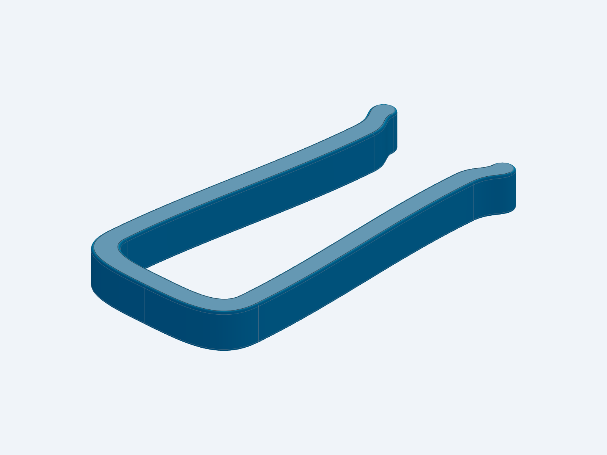
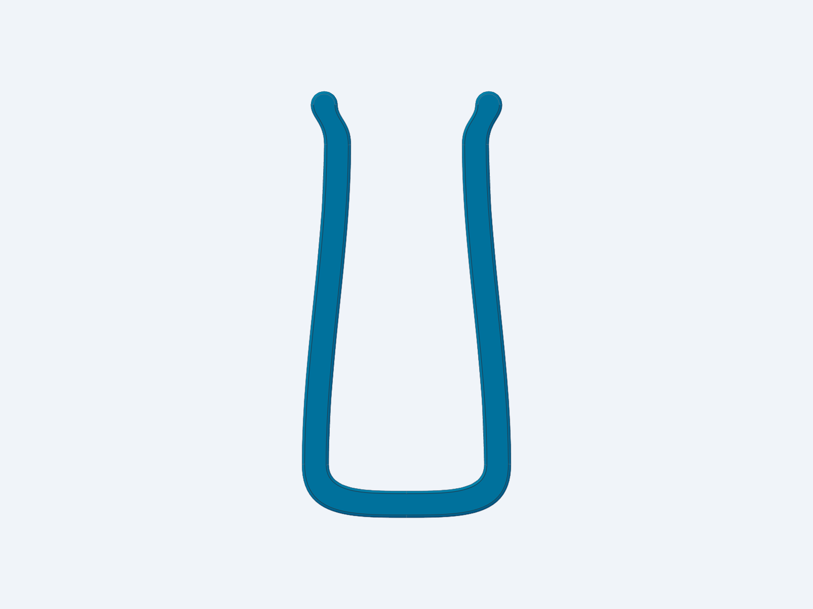

# Tapered bed-frame hook

Dimensions in mm. Opening at the crown shoulders: 35; narrow opening before
tip flares: 25. Smooth inward taper runs from y=12 to y=84. Both tips
flare outward 3 mm and have rounded ends. The opening widens locally at the
flare. Leg reaches from the inside crown (y=6): 90 on both sides.
Extrusion depth: 10. Nominal leg wall horizontal thickness: 6; rounded crown
and 0.6 mm edge softening. Smooth structural profile inspired by the supplied
reference; no decorative ribs added to the 10 mm extrusion.

Print with the broad face flat, as exported. No additional fit clearance.
Load capacity and furniture fit are not validated.

Source: src/bed_hook.py; exports: STEP/bed_hook.step and STL/bed_hook.stl.
checks/check_hook.py measures the saved solid, opening taper and leg reaches.


## Preview





## Rebuild

Generated with Python 3.12 and cadgen 0.6.5. From this folder:

```sh
python -m venv .venv
source .venv/bin/activate
pip install -r requirements.txt
python src/bed_hook.py
python checks/check_hook.py
```

To regenerate renders, install Chromium with `python -m playwright install chromium`,
then run `python -m cadgen.cli step snapshot --job renders/views.json`.
